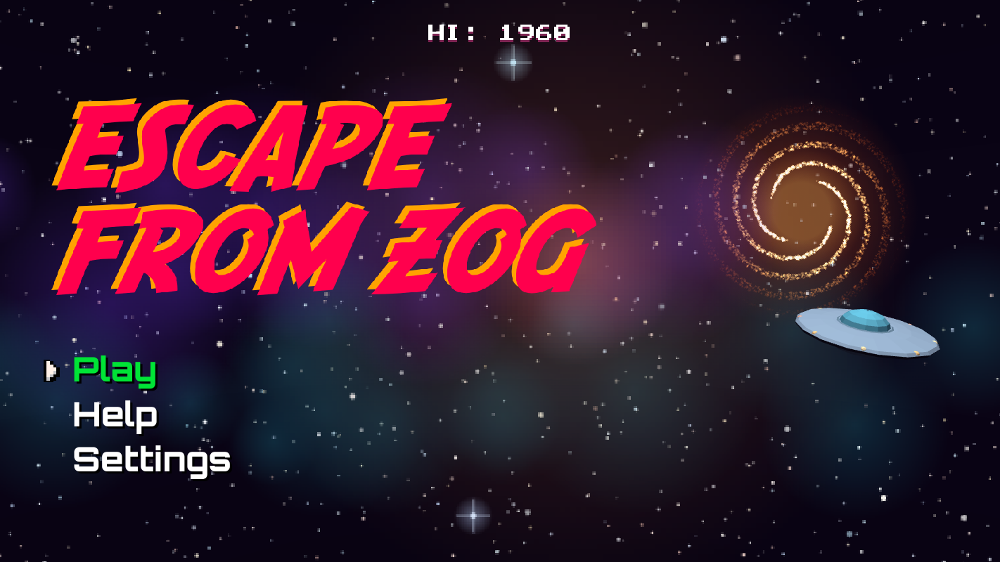
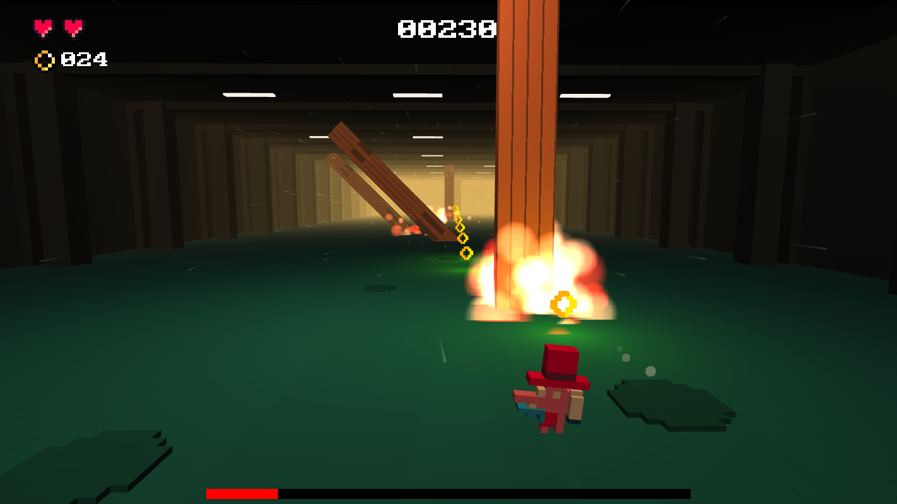
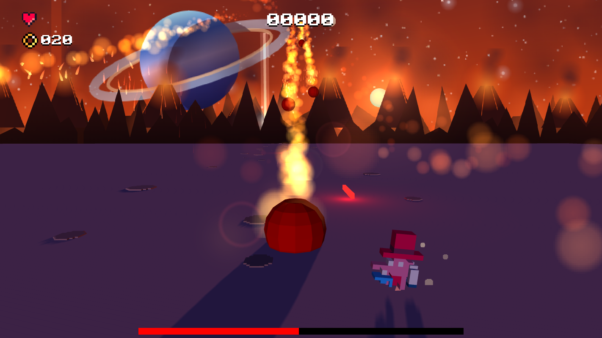
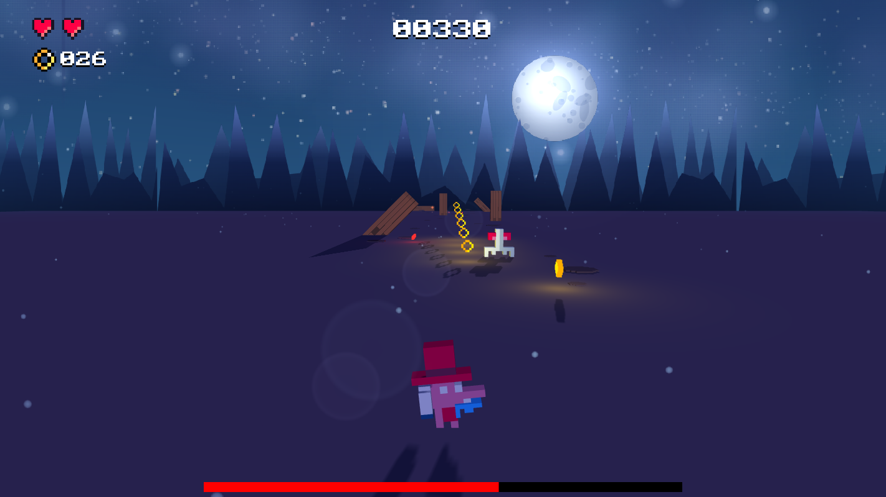

# Escape From Zog!

Entry for [LittleJS Game Jam 2026](https://itch.io/jam/littlejs-jam)

By [@eoinmcg](https://twitter.com/eoinmcg)
 

|  |  |  |
| :---: | :---: | :---: |

## Play here
[LittleJS Game Jam 2026 entry](https://eoinmcg.itch.io/escape-from-zog)

[WaveDash](https://wavedash.com/games/escape-from-zog)

[Latest version](https://eoinmcgrath.com/zog)

----

Controls:
- **X** zigzag
- **Z** Jump
- or use a gamepad
- Touch devices: Tap left or right
- [M] mutes music & sfx
- [P] pause
- [F] fullscreen

-----

Trapped on a hostile alien planet and the locals aren't friendly

Blast your way through the weird and wonderful world of planet Zog. 

There is one small problem: you can't walk in a straight line.

Zig left. Zag right. Dodge incoming nasties. Blast everything that moves. And whatever you do, don't get too comfortable - you're about to change direction again.

Zig. Zag. Zap. Survive.

-----

- [Music by David KBD](https://davidkbd.itch.io/interstellar-vol2-edm-metal-music-pack)

- [Made with LittleJS](https://github.com/KilledByAPixel/LittleJS)

